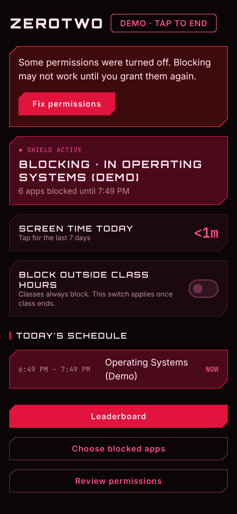
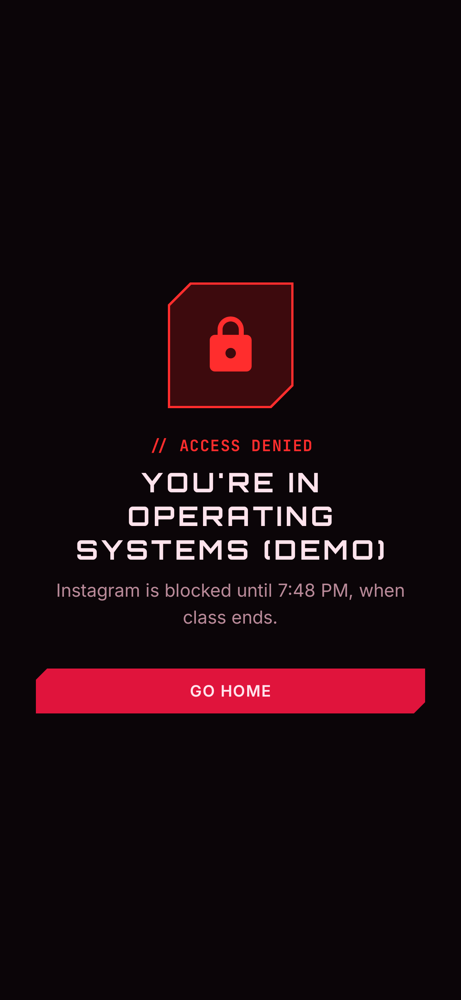
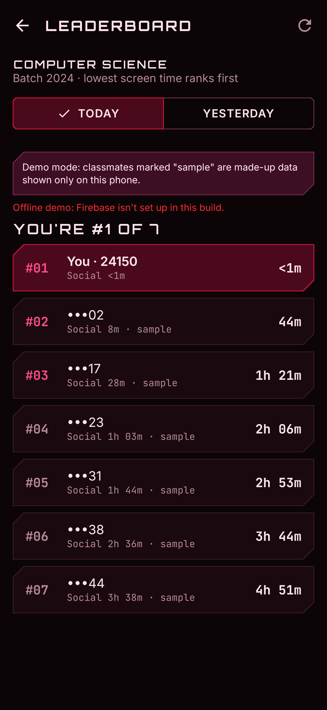
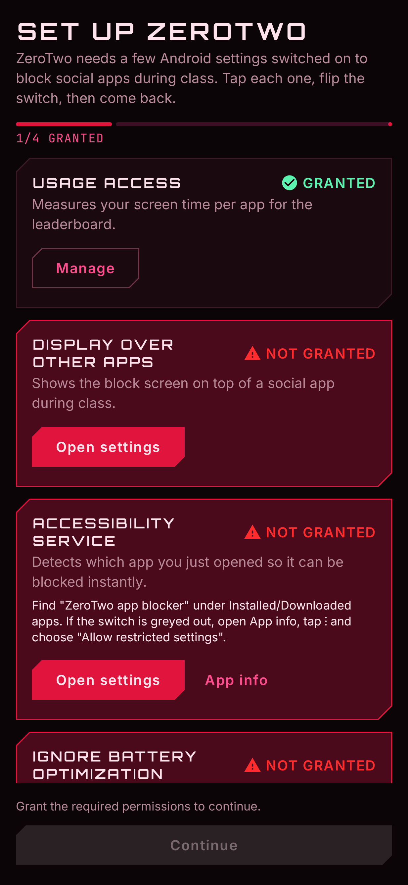

# ZeroTwo

**A class-aware screen time blocker for Android.** ZeroTwo knows your timetable: when a lecture starts, social apps lock automatically, and they unlock when class ends. Outside class you decide. A department/batch leaderboard ranks classmates by lowest screen time.

Built in 48 hours for a hackathon.

<p>
  
  
  
  
</p>

## Download

Get the latest APK from [**Releases**](../../releases/latest) (Android 8.0+).

1. Install the APK (allow "Install unknown apps" for your browser or file manager).
2. On Android 13+, if the Accessibility switch is greyed out: **App info → ⋮ → Allow restricted settings**.
3. Follow the in-app setup to grant the permissions.

## Features

- **Auto-block during class.** A timetable drives blocking: if a class is in session, Instagram, TikTok, Facebook, Snapchat, YouTube and X are blocked, and the switch can't be turned off mid-lecture.
- **Manual mode outside class.** One switch blocks the same apps during study time.
- **Full-screen block page.** "You're in *Operating Systems*", until when, and a Go Home button.
- **Screen time.** Per-app and total daily usage with a 7-day bar chart; social apps are tagged.
- **Leaderboard.** Students in the same department and batch, ranked lowest screen time first, with classmates' ERPs masked.
- **College ERP sign-in.** 5-digit ERP, department and batch. *Integration-ready, mocked for demo.*
- **Hidden demo mode.** Tap the **ZEROTWO** title 5 times: a fake class starts now and the leaderboard adds sample classmates, so the whole story works on one phone, even offline. See [`DEMO.md`](DEMO.md) for the 60-second script.

## How it works

| Piece | How |
|---|---|
| Detecting the open app | An **AccessibilityService** (reads the package name only, never screen content), with a **UsageStatsManager** check every second as a backup |
| Staying alive | A **foreground service** with a persistent notification, an optional battery-optimization exemption, and a restart after reboot or update |
| Deciding to block | One rule in `BlockPolicy`: class in session (or demo) → block; else manual switch on → block; else off |
| Screen time | Built from raw UsageStats events, split at local midnight; launcher and System UI excluded |
| Leaderboard | Firebase **Anonymous Auth** + **Firestore**, one document per student per day (`dailyScreenTime/{erp}_{date}`); no custom backend |

## Tech stack

Kotlin · Jetpack Compose · Material 3 · MVVM (single module, no DI framework) · Firebase Auth + Firestore · min SDK 26, target SDK 35.

UI: a dark "mecha-cockpit HUD" theme in crimson and pink, using Orbitron, Inter and JetBrains Mono.

## Configuration

Everything you'd want to change for a demo lives in clearly named files:

| What | Where |
|---|---|
| Apps that get blocked | `app/src/main/java/com/zerotwo/focus/config/BlockedAppsConfig.kt` |
| Class timetable (mock) | `app/src/main/assets/mock_timetable.json` |
| Departments, batches, ERP format (mock) | `app/src/main/java/com/zerotwo/focus/config/ErpMockConfig.kt` |
| Demo mode (fake class, sample classmates) | `app/src/main/java/com/zerotwo/focus/config/DemoConfig.kt` |
| Colors | `app/src/main/java/com/zerotwo/focus/ui/theme/Color.kt` |
| Firestore security rules | `firestore.rules` |

## Building

Requirements: JDK 17 and the Android SDK (platform 35).

```bash
./gradlew assembleDebug          # app/build/outputs/apk/debug/app-debug.apk
./gradlew testDebugUnitTest      # unit tests
./gradlew assembleRelease        # signed if keystore.properties exists (see below)
```

**Release signing** reads `keystore.properties` in the project root (not committed):

```properties
storeFile=/path/to/release.jks
storePassword=…
keyAlias=…
keyPassword=…
```

### Firebase (for the live leaderboard)

Without Firebase the app still builds and runs; the leaderboard then works in demo mode only.

1. Create a project at [console.firebase.google.com](https://console.firebase.google.com).
2. Add an Android app with package **`com.zerotwo.focus`** and put `google-services.json` in `app/` (it's gitignored).
3. Authentication → Sign-in method → enable **Anonymous**.
4. Firestore Database → create → Rules → paste [`firestore.rules`](firestore.rules) → Publish.
5. Rebuild.

## Permissions

| Permission | Why |
|---|---|
| Usage access | Screen time, and the backup app detector |
| Display over other apps | Showing the block screen on top of a blocked app |
| Accessibility service | Instant detection of which app was opened |
| Ignore battery optimization (optional) | Keeps the blocker from being killed |
| Notifications | The persistent "blocking" notification (blocking works without it) |

## Known limitations

- The ERP link is **mocked**: student IDs are self-declared, so the leaderboard trusts what the phone sends.
- Timetable classes can't cross midnight, and the timetable follows the phone's clock.
- Some OEM skins (Xiaomi, Oppo, Vivo, …) need extra Autostart / pop-up switches; the app explains them during setup.

More detail: [`PROGRESS.md`](PROGRESS.md).

## Credits

Fonts: [Orbitron](https://github.com/theleagueof/orbitron), [Inter](https://github.com/rsms/inter) and [JetBrains Mono](https://github.com/JetBrains/JetBrainsMono), all under the SIL Open Font License; see [`licenses/`](licenses/).
